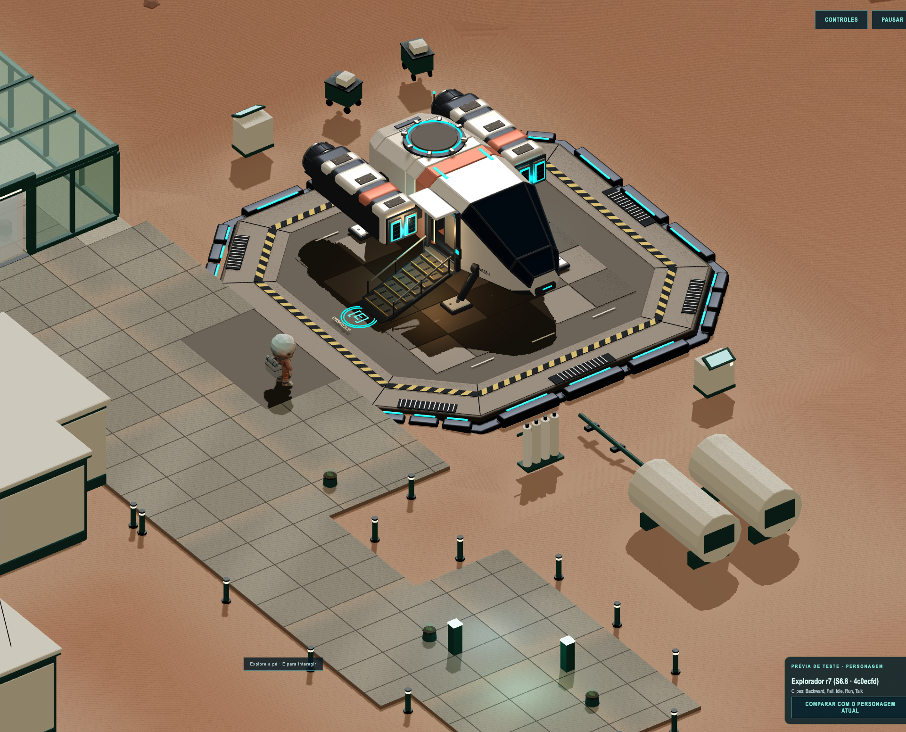
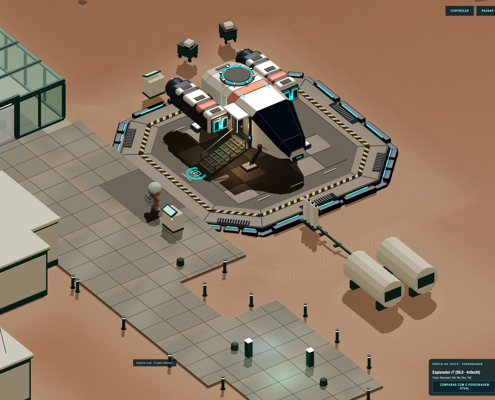
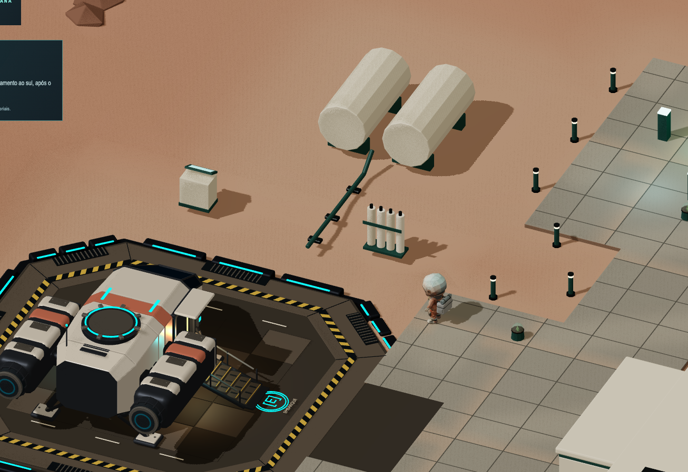
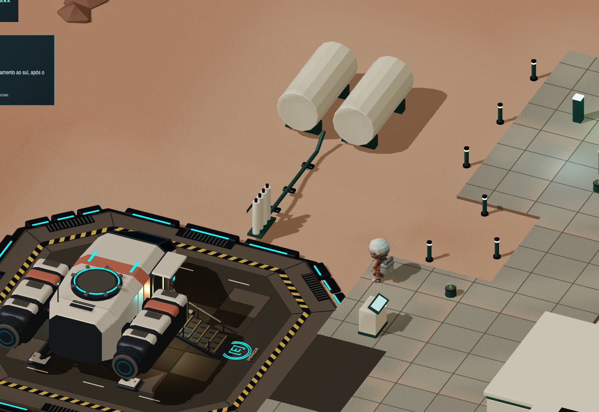

# S0.4 · Consoles e rack do acesso ao deck de Marte

Pedido e execução em 24/10/2026. Base **`0c56448055a65cef3813171f48035ae02259eb69`**,
branch/worktree `rochatales/fechamento-s0-s2`,
`/Users/rochatales/.codex/worktrees/fechamento-s0-s2/game-workplace`.
Ajuste de posicionamento aprovado para execução; avaliação visual final é do autor.

## Posições finais

Centros geométricos X/Z, em metros; bases em Y=0 e altura 1,165939 m:

| Prop | Antes (X; Z) | Depois (X; Z) | Orientação / colisão |
|---|---|---|---|
| PLAT_Console_Oeste | (−8,191501; 35,400002) | **(−3,00; 25,90)** | Rotação Y=π; tela para −Z, voltada a quem chega da colônia. Um colisor simples de movimento |
| PLAT_Console_Leste | (8,191501; 31,799999) | **(6,85; 31,80)** | Y=π/2 preservado; fora da área caminhável, sem colisor novo |

A rotação do Oeste troca a pegada para **0,94 × 0,723003 m**. Limites visuais:
X **−3,470000…−2,530000**, Z **25,538498…26,261502**.
Colisor conservador (margem de até 0,1 mm): X **−3,4701…−2,5299**,
Z **25,5384…26,2616**. Segue a extrusão padrão de movimento do piloto; nenhum tiro
é simulado em Marte. O Leste mantém pegada 0,723003 × 0,94 m, com limites
X **6,488498…7,211502**, Z **31,33…32,27**.

Os centros diferem das origens dos nós GLB. Após o ajuste, as origens são Oeste
(−3; 0; 25,941502) e Leste (6,808498; 0; 31,8). `applyColonyLayout` calcula a
translação pela caixa real do objeto após orientar a tela, só na cópia da cena.
Nada é alterado no GLB, manifesto, Blender ou cache; o rack recebe o complemento abaixo.

## Complemento do autor — rack e tubo

Incorporado ao mesmo commit dos consoles, por pedido expresso do autor; o novo
SHA substitui o commit local anterior `350b584`, sem push ou merge na integração.
A base da tarefa continua sendo `0c56448`.

`PROP_Tanques` contém três malhas por material. O tubo está **fundido em
`PROP_Tanques_2` (M_Estrutura)**, junto a apoios dos tanques grandes: não é um nó
isolado que possa ser transladado/escalado sem afetar outras peças. Foi mantido
intacto, conforme a alternativa autorizada pelo autor.

| Referência | Resultado final |
|---|---|
| Rack, centro geométrico X/Z | **(−6,75; 31,60)**, antes (−8,24; 29,60) |
| Rack, orientação | Rotação Y=0; fileira no eixo X, perpendicular à borda oeste |
| Rack, limites X/Z | X **−7,35…−6,15**, Z **31,34…31,86**, pegada **1,20 × 0,52 m** |
| Rack, origem do nó / altura | (−6,75; 0; 31,59); altura 1,44 m, base Y=0 preservada |
| Borda/para-choques reais na faixa do rack | **X=−6,08** |
| Folga rack → deck | **0,070000 m**, sem sobreposição com borda/para-choques/faixas |
| Ponta original do tubo (X; Y; Z) | **(−7,250001; 0,150000; 31,600000)**, sem deslocamento |
| Tanques grandes | `PROP_Tanques` preservado em (−13,5; 0; 31,600000), todas as malhas e transformações intactas |

A diferença para a primeira hipótese é **mover e girar somente o rack**, não
alongar/encurtar o tubo: o centro avança cerca de **1,49 m em X e 2,00 m em Z**,
e a fileira gira 90°. Assim a ponta existente entra no primeiro cilindro e o
rack chega ao deck, com 7 cm de respiro. Testes de raycast **apenas para QA**,
nos dois sentidos de X a partir da ponta, encontram a superfície real desse
cilindro a 0,0673 e 0,1673 m: a conexão não foi inferida só de caixas AABB.

Rack inteiro com X < −6,15, fora da área caminhável; **nenhum colisor novo**.
Mantêm-se os 133 volumes de Marte (incluindo o único console Oeste), área
caminhável, passarela, chegada/embarque e ARES-I. Nada foi editado/reexportado
em GLB/.blend nem deslocado nos tanques grandes.

## Medição contra o deck real

[Script](medir.mjs) e [medidas completas](medidas.json). Todos os triângulos do GLB
foram recortados pelas faixas X/Z das pegadas; não se usou apenas a caixa geral,
que incluiria a passarela e daria falsa sobreposição no Oeste.

| Verificação | Valor |
|---|---:|
| Face sul do deck/para-choques na faixa do Oeste | Z=26,920000 m |
| Folga visual Oeste → deck | **0,658498 m** (colisor: 0,658400 m) |
| Folga Oeste → limite X=−2 da passarela | **0,530000 m** (colisor: 0,529900 m) |
| Distância mínima da pegada Oeste → embarque (0; 29,5) | **4,109595 m** |
| Borda/para-choques Leste, na faixa Z do console | X=6,080000 m |
| Folga Leste → borda real | **0,408498 m** |
| Base do Oeste / topo do piso da praça | **Y=0 / Y=0** |

Z=26,3 não deixaria a folga mínima solicitada; Z=25,9 foi escolhido após medir e
inspecionar a câmera real. O Oeste fica apoiado no piso da praça, fora da geometria,
faixas e borda do deck, sem sobreposição visual/z-fighting observado. A passarela
X −2…2 permanece livre. Não se muda o desembarque nem qualquer colisor ARES-I.

Hashes de assets preservados:

- Colônia GLB: `5a6e6d9c754a8d25296b58598859cff0a9c2b4f9c964306d218bf9b8c71c87a8`.
- Deck GLB: `59b4cb7dbeb09699416207cc97863a42027f2cd131f887b9caf4050bbf121354`.
- `git diff 0c56448 -- src/assets art-source`: vazio; nenhum GLB/.blend foi editado.

## Capturas na câmera do jogo

Mesmo azimute **215,5°**, zoom **79**, posição do jogador **(−1,25; 26,1)**,
viewport **2722 × 1552**, DPR 1; recorte **1922 × 1552** a partir de X=760.
Câmera isométrica real (`CameraRig`), aproximando o ângulo/enquadramento da imagem
do autor. Não há parâmetros de câmera na imagem para alegar identidade pixel a
pixel com ela. As duas capturas usam os mesmos parâmetros entre si; diferenças
de convergência da câmera são menores que 1 mm / 0,001 de zoom.

| Antes · build-base 0c56448 | Depois · ajuste local |
|---|---|
| [Abrir antes.png](antes.png) | [Abrir depois.png](depois.png) |





### Segunda vista do autor — noroeste

Azimute **−24°**, zoom **66,7**, jogador (−5,6; 26,9), viewport 2000 × 1240,
recorte 1306 × 898 em (175; 40), DPR 1. Mesmos parâmetros antes/depois, na câmera
real. A referência de antes usa os módulos de posicionamento de `0c56448`
servidos somente em memória por [base.vite.mjs](base.vite.mjs), na **mesma
worktree**, sem reset/checkout/edição de fontes; assets idênticos.

[Abrir antes noroeste](noroeste-antes.png) · [Abrir depois noroeste](noroeste-depois.png)





Metadados desta vista: [noroeste-antes.json](noroeste-antes.json) e
[noroeste-depois.json](noroeste-depois.json). A captura sudoeste acima foi
atualizada também para mostrar consoles e rack juntos.

Dados da câmera, bounds dos consoles e console da página: [antes.json](antes.json)
e [depois.json](depois.json). **Zero erros de página.** Capturas em DEV, Chromium
headless com GPU, reposição assistida apenas para iniciar os percursos. Não são
aceite de jogabilidade nem medição de desempenho.

## Verificações

- **113/113** em `npm test`: quatro testes novos de posicionamento dos GLBs reais,
  orientação/cache, passarela/conectividade, bloqueio Rapier pelas quatro faces e
  posição do rack/conexão real com a ponta do tubo, preservando tanques grandes.
  Dois testes anteriores foram atualizados para reconhecer o único novo colisor,
  mantendo os 126 obstáculos da colônia e os seis volumes ARES-I intactos.
- `npm run build` e `git diff --check`: passaram. Aviso conhecido de chunk >500 kB.
- Navegador: W sustentado desde (0; 20) percorreu praça/passarela e parou em
  (≈0; 28,55233); E abriu a cabine e Desembarcar voltou a **(0; 29,5)**.
- W contra o Oeste desde (−3; 24,2) parou em **(≈−3; 25,158308)**, antes da
  face sul do console; controlador não atravessou o prop.
- Caminho colônia (0; 0,8) → embarque revalidado segmento a segmento a raio 0,36 m;
  cinco trajetos pela largura X −2…2 da passarela continuam livres.
- Nenhuma modificação em Shanghai, combate, ARES-I, arte, dependências ou saves.

Reprodução na worktree:

```bash
npm run dev -- --host 127.0.0.1 --port 5184 --strictPort
```

Em outro terminal, `node docs/handoffs/fechamento-s0-s2/consoles-marte/capturar.mjs depois`
e `node docs/handoffs/fechamento-s0-s2/consoles-marte/medir.mjs`.
Para a vista noroeste, acrescentar `noroeste` ao comando de captura.
Para recriar o antes sem tocar nas fontes, iniciar a referência em outro terminal:

```bash
npm run dev -- --config docs/handoffs/fechamento-s0-s2/consoles-marte/base.vite.mjs --host 127.0.0.1 --port 5185 --strictPort
```

Usar `HORDA_QA_URL=http://127.0.0.1:5185/ node docs/handoffs/fechamento-s0-s2/consoles-marte/capturar.mjs antes noroeste`
(omitir `noroeste` para a primeira vista). O modo `antes` requer essa referência
0c56448; não sobrescrever a evidência com o runtime modificado. Scripts usam o Playwright já disponível no runtime
local; não alteram dependências do projeto.

## Roteiro do autor

No build atualizado da worktree de fechamento, porta 4173: sair da colônia até o
deck, conferir tela voltada à chegada e folgas, tentar atravessar o Oeste e passar
por ambos os lados, caminhar pela passarela, embarcar/desembarcar em (0; 29,5),
girar Q/C e conferir ambos os consoles e a fileira de cilindros junto à borda
oeste (−6,75; 31,6). A ponta do tubo deve entrar no primeiro cilindro, com os
tanques grandes no lugar e sem sobreposição com os para-choques. Leste e rack
não devem criar obstáculos fora do octógono. Resultado no item **S0.4 · deck ARES-I** do kit, ainda **pendente**.

Sem push, merge na integração, remoção de worktrees ou aceite marcado pelo agente.
