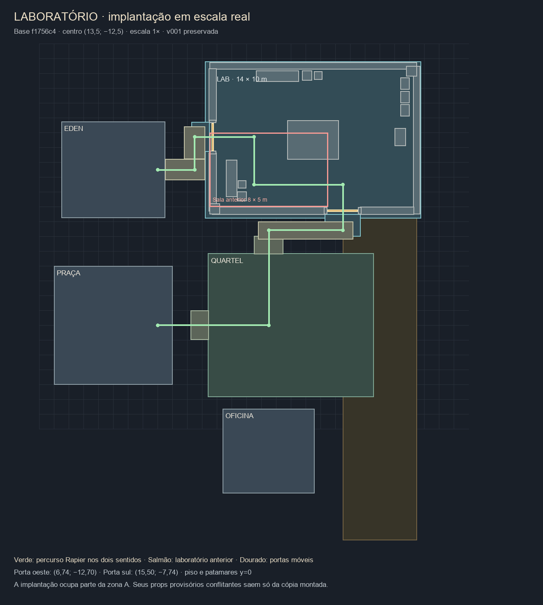

# S6.12 — Laboratório com sintetizadora na colônia

## Correção dos corredores no contorno do quartel — 29/10/2026

Pedido do autor após a correção EDEN/Lab: bloqueios semelhantes ao contornar o quartel, com ajuste dos pisos. Base `f64041c`; mesma branch/worktree. O teste reproduziu a parada em **(14,449974; −5,5)** ao tentar chegar a X=15: a antiga circulação norte terminava em 14,5 e a zona A começava em 15,5. Outra lacuna ficava ao sul, entre X=13,75 e 15,5.

Duas ligações passam a ter piso e área caminhável correspondentes:

| Trecho | X | Z |
|---|---|---|
| Nordeste do quartel | 14,5–15,5 | −5,8–−4,8375 |
| Sudeste do quartel | 13,75–15,5 | 4,8375–5,75 |

São **2,559375 m²**, **143 triângulos**, uma malha/material de pavimento, sem colisores novos. Tile original de 1,25 × 1,50 m, juntas de 30 mm, mesma fase mundial e cores por vértice; teste compara quatro pontos à repetição de 5 m do piso v007. Derivado pelo script `art-source/quartel/scripts/build_circulation.py`; arquivo/manifesto `quartel-circulation-v001`. Não houve alteração nos modelos do quartel/laboratório, no v007 original ou no checkout principal.

O recorte antigo pelo centroide também apagava pavimento ao redor dos cantos arredondados da base. O piso em y=0 agora permanece sob a base elevada (0,2625 m), cobrindo os cantos externos; apenas as duas rampas, que chegam ao chão, recebem recorte exato por bordas para evitar sobreposição. Testes com raycast confirmam piso nos quatro cantos e ausência de piso duplicado sob as rampas. As geometrias derivadas são descartadas na desmontagem e o cache original é preservado.

As duas áreas entram no mundo e no cadastro de corredores. O componente `QuartelCirculation` permanece fora do pai de descarte do prédio e recebe o shader Sandwind usando o mesmo cache GLB; teste verifica visibilidade/limpeza de recursos. A fixture Sandwind completa inclui o novo piso.

**Verificação:** 306/306 testes, npm run build e git diff --check verdes. O novo percurso com as funções reais do controller + Rapier percorre todo o perímetro em ambos os sentidos: oeste → norte/rampa → leste → sul → oeste. Testes existentes de borda não escalável, rampas, portas, teto e interiores permanecem verdes. Registro em `v002/contorno-verificacao.txt`.

O trecho entre quartel e Oficina mantém seu vão físico existente, cerca de 0,78 m entre colisores; a rota validada passa em Z=5,25. Esta entrega não move a Oficina, não reduz os colisores e não muda raio/offset/autostep. O roteiro do autor inclui conferir a folga desse trecho durante a volta completa.

Build de produção atualizado na porta **4189**. A abertura da versão com `rev=quartel-circulation-20261029` foi solicitada ao painel do app; a ferramenta retornou `queued`. Acesso nativo ao app foi negado pela ferramenta de computador, portanto não houve nova captura visual nesta correção. Abrir/recarregar a prévia e dar a volta completa nos dois sentidos é o roteiro de revisão. Aceite visual/jogabilidade pendente. Sem push ou merge.

---

## Correção da circulação EDEN/Laboratório — 28/10/2026

Pedido do autor: bloqueio invisível no corredor entre laboratório e sala de EDEN. Base `cde68aa`, mesma branch/worktree. A integração excluía `open-eden-lab-circulation` junto com o piso da sala antiga. A faixa continuava pavimentada visualmente, porém apenas os trechos em L eram caminháveis: o controller parava nos limites desses trechos.

Reprodução antes da correção: partindo de (4,1; −10,5) em direção a (4,1; −13,2), o personagem parava em Z **−11,199997**, exatamente na borda do conector estreito. A fixture agora executa as funções reais `fitsWalkableAreas`/`constrainToWalkableAreas` do PlayerController, selecionadas pelo AST e transpiladas, antes de cada passo Rapier. Assim o teste cobre tanto o limite de piso quanto os colisores; não duplica a implementação do controller.

A correção preserva a faixa original `open-eden-lab-circulation` (X 3,5–6,5; Z −13,75–−7,25), restaurando toda a circulação pavimentada. O manifesto ativo e o script gerador v002 concordam. Arte, GLB, colisores das estruturas, portas e parâmetros de movimento preservados. Não foi necessário reexportar o GLB.

Novo teste percorre norte/sul por X **4,1 / 4,9 / 5,9**, em ambos os sentidos, incluindo a ligação ao caminho da praça. Os percursos de entrada nas duas portas continuam passando com o limite real de piso aplicado.

**Verificação:** 302/302 testes verdes, npm run build verde e git diff --check verde. Registro em `docs/sprint-6/laboratorio-colonia/v002/corredor-verificacao.txt`. A conexão CUA com a aba retornou `browser.user is unavailable`; esta correção não teve nova inspeção visual pela ferramenta nem recarga automática da aba. O build de produção em 4189 foi atualizado; recarregar a prévia e percorrer toda a largura do corredor nos dois sentidos é o roteiro do autor. Aceite de jogabilidade pendente. Sem push ou merge.

---

## Revisão v002 — pisos, casca completa e fade (28/10/2026)

Pedido do autor após a prévia: pisos interiores piscando, passarelas sem o padrão da colônia, paredes/teto ausentes. Base desta correção: `6154ebf`; mesma branch/worktree, sem tocar no checkout principal. V001, backup, atlas e quatro clipes originais preservados byte a byte. Variante reproduzível com `art-source/laboratorio-sintetizador/scripts/build_laboratorio_v002.py`, gerando `.blend`, export e manifesto v002. Os consumidores atuais usam `laboratorio-v002.glb`.

### Pisos

Havia duas superfícies superiores do ativo em y=0: o pedestal completo (154,76 m²) e o piso interno (140 m²), além dos patamares. Foram retiradas três faces redundantes e conservado um anel de borda de 30 cm. Agora o conjunto interno tem **154,76 m² em uma única camada superior**. Patamares e passarelas formam uma união de **15,79 m²**, excluindo a área já coberta pelo pedestal. Isso elimina também a sobreposição de 1,32 m² nas duas soleiras.

A cópia montada do v007 agora sofre recorte exato por bordas de triângulos, interpolando todos os atributos; não usa mais exclusão pelo centroide no laboratório. Fragmentos que cruzavam os limites não ficam abaixo da nova malha. Os originais permanecem intactos e as geometrias derivadas são descartadas na desmontagem.

Exterior gerado com o mesmo `scripts/colony_floor_geometry.py` e tile real `ARQ_Lab_Piso_Patio` que produziram o v007: placas **1,25 × 1,50 m**, juntas **30 mm**, grade mundial e poeira/desgaste em COLOR_0. Material `M_Piso_Patio_Vcol`. Teste compara as cores interpoladas em quatro posições mundiais com o GLB v007. Não é textura aproximada nem plano liso elevado para esconder conflito.

### Paredes e teto

Casca fechada do lado de fora, paredes de **3,60 m**, preservando posição, escala 1× e vãos/portas. `Building_Roof` separado, topo a **3,93 m**, friso escuro. `Building_Walls` contém apenas os complementos altos do antigo recorte sul/oeste; as paredes originais e peitoris continuam no ativo original derivado.

Quando o personagem ocupa o interior (margem de 5 cm na entrada), **teto e complementos altos sul/oeste fazem fade juntos**, com o mesmo fator exponencial das demais salas. Assim o personagem continua visível no recorte. Ao sair, voltam a fechar o prédio. Norte/leste permanecem visíveis, como na arte original. Teto e complementos compartilham um material privado; piso, máquina e portas não têm opacidade alterada. Pausa congela a transição. As quatro caixas das paredes e a caixa do canto sudoeste passam a 3,60 m; vergas atualizadas. Física nunca acompanha `visible`.

O pai exclusivo Sandwind continua controlando distância do prédio inteiro; não disputa `visible` com teto/recorte. Passarelas permanecem fora do descarte. Cache useGLTF inclui o material final da v002; o material privado do fade é preservado pelo shader e descartado uma vez. A malha/materiais das passarelas agora pertencem ao cache GLB, sem a criação de piso procedural a cada montagem.

### Métricas e evidências

| Peça | Triângulos |
|---|---:|
| Interior + máquina + paredes originais | 7384 |
| Complementos altos sul/oeste | 84 |
| Teto/friso | 60 |
| Passarelas/patamares com tile original | 1092 |
| Total ativo v002 | 8620 |

Dois materiais de origem: atlas autoral e piso externo com cores por vértice; mais uma instância privada do atlas em runtime para o fade. Quatro malhas/chamadas principais antes de sombras; separar o teto e o piso externo é necessário para seus comportamentos independentes. SHA-256 GLB v002: `4dfd07a28d6a6d017233a0a085a80a60e8a4275345070b90f9fdb2d0a32502c8`. Medidas, referência do tile e hash em `notas/validacao-v002.json`.

Novos testes cobrem área superior sem duplicatas, patamares fora do pedestal, equivalência de cores/fase do tile, recorte com centroides fora da área, preservação de UV, fade/pausa/retorno e Sandwind durante a transição. Portas e percurso Rapier nos dois sentidos continuam exercitados.

**npm test: 301/301 verdes; npm run build verde; git diff --check verde.** Verificação técnica no build de produção em 4189: exterior com casca/teto presentes, entrada com teto e paredes do recorte ocultos, personagem visível e piso sem o padrão alternado anterior ao girar Q. Console sem erros nesta inspeção. Evidências em `v002/01-interior-teto-oculto.png` e `v002/02-exterior-teto-presente.png`. Essas capturas não constituem aceite visual ou de jogabilidade. Revisão Claude e aceite visual/jogabilidade do autor continuam pendentes. Sem push ou merge.

Roteiro adicional: recarregar 4189; aproximar pelas duas portas, observar teto/casca externos; entrar, caminhar em ambos os sentidos e girar a câmera Q/C pelo piso/soleiras; sair e conferir reconstrução do volume; repetir durante um fade com descarte Sandwind e pausa. Conferir o encontro do piso da passarela com o corredor da colônia. Capturas novas em `docs/sprint-6/laboratorio-colonia/v002/`.

---

## Registro anterior — integração v001 (histórico)

Implementação Codex em 28/10/2026. Base explícita `f1756c4923e758cf4e8ced985e7a8f23b94c62dc`, ponta local do quartel v006 com colisores internos e banheiro automático. Branch/worktree `rochatales/s6.12-laboratorio-colonia` / `s6-12-laboratorio-colonia/game-workplace`. Quadro de integração preservado conforme AI_WORKFLOW. Sem push ou merge; revisão Claude e aceite visual/jogabilidade do autor pendentes.

## Resultado

O GLB finalizado pelo autor substitui `smart-lab` na cópia montada do v007. O arquivo v007, seu manifesto, `marsMasterplan.json`, o checkout principal e as fontes v001 permanecem intactos. Origem copiada de `art-source/laboratorio-sintetizador` do checkout principal; os 32 arquivos, inclusive backup, foram conferidos por SHA-256 em `art-source/laboratorio-sintetizador/notas/origem-v001.sha256.json`. A prancha informada foi preservada em `notas/laboratorio_sintetizador_walkthrough.md`. Scripts originais têm caminhos absolutos históricos: não foram executados.

- GLB de runtime idêntico ao exportado, SHA-256 `d4d1694d3ad07cc97054fd6effa4d111882f00399f14c99ac62adb89b14de66b`.
- Blender 5.1.1: **7.382 triângulos, 3.527 faces, 4.453 vértices, uma malha e um material**. Quatro clipes importados. Nove ossos autorais; o exportador acrescenta `neutral_bone` para as partes estáticas (dez joints no GLB).
- Atlas original preservado. Um material/chamada da malha fonte, antes de passes de sombra. Passarelas novas: uma malha, um material, seis triângulos adicionais; sua chamada não integra a métrica de uma chamada do ativo fonte.
- Corte 90° permanente, sem teto no ativo; não foi inventado um telhado nem aplicado fade ao material único. Norte/leste com 3,60 m; sul/oeste com peitoril 0,85 m e capa até 0,89 m.

## Implantação e rotas

Centro **(13,5; −12,5)**, rotação zero, escala **1×**. Preserva 14 × 10 m de paredes; piso-base 14,60 × 10,60 m. Com patamares, caixa completa X **5,30–20,80**, Z **−17,80–−6,00**, Y **−0,40–3,60** (4 m totais). Piso/patamares em y=0; a base enterrada não cria degrau nem exige alterar o controller. Limite norte caminhável/câmera de Marte ampliado de −15 para **−19**. Shanghai permanece com seus limites.

Porta oeste em **(6,74; −12,70)** e sul em **(15,50; −7,74)**. Passarelas com duas quinas conectam EDEN à porta oeste e a rampa norte do quartel à porta sul. O corredor do quartel vira trecho horizontal de **6,40 × 1,20 m**, Z −7,00–−5,80. Piso caminhável conserva ambas as rotas; o raio real 0,32 m e o offset/autostep originais foram usados nos testes Rapier, nos dois sentidos.

O laboratório cresce para norte/leste e ocupa parte da zona A. Saem apenas da cópia montada os marcadores conflitantes, a grade provisória A, os cinco `Suprimentos_A_*` e a cerca norte que ficariam dentro do laboratório. Seus nove colisores também saem; não são caixas de loot da S6.13. A fonte v007 conserva esses elementos. Quartel, EDEN, Oficina, Hangar, estufa, ARES e caixa de suprimentos S6.13 preservados. Builder/setorização não implementados.

## Física e comportamento

**25 caixas estáticas + duas móveis**, reproduzindo os sólidos do script fonte: paredes, batentes, vergas, cantos, máquina, bancadas, caixotes, armários e console. Nenhum trimesh. Vergas altas não entram na consulta plana de navegação. Saem também `interior-37` e `interior-38`, os dois mobiliários físicos da sala anterior. Partes móveis só usam caixas cinemáticas.

Portas deslizam por proximidade (2,70 m), com suavização e deslocamentos de 2,30 m na sul e 2,10 m na oeste, liberando o vão. Os clipes originais têm tracks de todos os ossos, incluindo portas: o runtime cria clipes de máquina sem os tracks das duas portas. Assim os quatro modos não fecham nem reiniciam a porta durante a passagem. Colisor e osso recebem o mesmo deslocamento, validado contra os vértices realmente deformados em todos os quadros.

Cada runtime procura suas caixas móveis por ID no mundo compartilhado; o quartel não depende da ordem de uma lista que agora contém outro prédio. Pausa congela animações/portas. O esqueleto é clonado com SkeletonUtils e seu bone texture próprio é descartado ao desmontar; geometria/texturas/material fonte continuam no cache. A geometria/material próprios das passarelas são descartados.

Próximo ao console: **E · Sintetizadora de diamantes** abre controles Pronta / Sintetizar / Abrir gaveta / Espera. São os quatro clipes fornecidos; gaveta executa um ciclo e espera no último quadro, Espera mantém a pose final, os outros repetem. O painel some ao se afastar e durante pausa/viagem. Nenhuma produção, custo, inventário ou progresso foi criado; esses contratos pertencem ao ciclo funcional da máquina no Sprint 5. Save `exoden:hub:v1` e id `smart-lab` preservados.

## Sandwind

Laboratório inteiro em um pai de descarte exclusivo `SandwindDistance_laboratorio`. Portas/ossos continuam atualizando sem disputar `visible`, emissivo ou opacidade. Caixa inteira inclui patamares; o shader é instalado no material final e encadeia o hook original. Passarelas ficam fora desse pai para manter a rota visível. Mesmo GLB/cache nas chamadas useGLTF do prédio e de ColonySandwind. O efeito continua só com `?sandwindPreview`, em Marte. Nenhuma importação do laboratório no runtime de Shanghai.

## Verificação automatizada

- Blender: `--background --python art-source/laboratorio-sintetizador/scripts/prepare_runtime.py`; lê a cópia v001 sem salvar por cima, gera manifesto e `notas/validacao-runtime.json`. Medidas/grupos/contagens registradas.
- Testes novos: SHA-256, malha/rig/clipes, implantação/escala, remoção da sala anterior sem alterar vizinhos, IDs de save/HUD, caixas móveis contra vértices deformados, pausa, quatro modos, Sandwind/caches em três montagens, Rapier em ambas as rotas e bloqueio de portas/mobiliário/paredes, passarelas sem sobreposição.
- Testes existentes atualizados só onde a implantação antiga do laboratório era pressuposta. Percurso quartel→Lab segue agora a passagem em L; os demais contratos do quartel e do v007 permanecem exercitados. Fixture Sandwind completa inclui o laboratório.
- **npm test: 296/296 verdes** (289 anteriores + sete novos); **npm run build verde**; **git diff --check verde**. Build mantém o aviso conhecido de chunks acima de 500 kB.

## Evidências e roteiro do autor

Build de produção em http://127.0.0.1:4189/?sandwindPreview&perf&sandwindQA . As poses adicionais só funcionam com as três flags e Marte caminhando; não gravam posição no save. Evidências técnicas não equivalem a aceite.

1. De EDEN, contornar o pequeno trecho a oeste e entrar no laboratório; verificar abertura/fechamento e não atravessar peitoris.
2. Caminhar ao redor da máquina, bancada, armários e caixas; conferir bloqueio e folgas.
3. Sair pela porta sul, seguir a passarela em L e subir a rampa norte do quartel; voltar pelo mesmo caminho. Teto/banheiro/portas do quartel devem funcionar como antes.
4. No console leste, E e testar os quatro modos; aproximar-se das portas durante uma síntese. Pausar e retomar; conferir poses congeladas durante a pausa.
5. Testar sem flag e nos três alcances Sandwind; afastar/voltar e conferir laboratório inteiro, sem sumir porta isolada. Passarelas/física/interação devem permanecer.
6. Viajar para Shanghai e voltar, conferindo ausência de efeito/laboratório em Shanghai. Fazer a revisão de enquadramento, escala, materiais e sensação de movimento.

Capturas e planta em `docs/sprint-6/laboratorio-colonia/`. Revisão Claude, aceite visual e jogabilidade pendentes do autor. Sem push, sem merge.

## Conferência em produção

Inspeção no build de produção em 4189, sem erros de console; permanece o aviso histórico de personagem GLB sem partes de braços. E abriu o console e Sintetizar selecionou o modo correto. Capturas 01/02 mostram máquina e implantação; 03 registra Shanghai sem o laboratório nem o painel Sandwind; 04 mostra a porta sul aberta; 05 verifica o laboratório na colônia sem a flag Sandwind e sem erros de console.

Três idas/voltas pela cabine real, em sequência, com o mesmo enquadramento a bordo no retorno: **472 geometrias / 12 texturas / 27 programas** em cada volta. Sandwind: **1 controlador / 46 clones / 133 patches** em cada volta. JSONs completos `recursos-volta-1.json` a `recursos-volta-3.json`, com eventos das seis viagens. O cache de modelos permanece carregado conforme o projeto; isso mede contagens de objetos/programas no cenário escolhido, não bytes de VRAM nem benchmark de GPU. As poses de QA rematerializam jogador/câmera, por isso não foram usadas como medição de memória entre as viagens.

Fontes do laboratório no checkout principal foram conferidas novamente por SHA-256 ao final; nenhuma alteração. O servidor de revisão do quartel em 4188 permanece separado. A aba de revisão desta entrega usa 4189. Aceite visual e de jogabilidade continuam pendentes.
