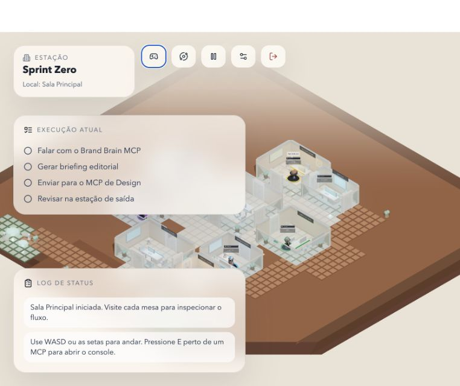

# Sprint 0 — Preservação e baseline

Data do registro histórico: 28/09/2026. Atualização S0.4 em 19/10/2026 (Fase 5.1), base de runtime `796ae3a6776a623fb2c839310f04eb58925efc93`. **Atualização de 25/10/2026: S0.4 aprovada pelo autor e Sprint 0 encerrado** (ver "Sessão manual do autor — 25/10/2026").

As seções até a captura do escritório preservam o contexto histórico do produto anterior. O roteiro atual e a evidência do build consolidado estão abaixo; não executar servidor/backend ou controles antigos para esta validação.

## Entregas concluídas

- Branch criada: `rochatales/horda-survivor`, a partir de `main`.
- Commit de referência: `99ab0d71ee1a84b046b2021de327f155829b4628`.
- Nenhuma alteração em fontes de gameplay, assets originais, dependências ou lockfiles.
- Snapshot local fora do repositório: `/Users/rochatales/Automations/game-workplace-backups/sprint-0-20260928-205149`.
- Histórico preservado em `repository.bundle`; `git bundle verify` passou.
- 96 arquivos não rastreados preservados em `untracked.tar.gz`, total original de 200,621,419 bytes; cada conteúdo foi relido do arquivo compactado e comparado por SHA-256 ao original.
- Patches staged/unstaged preservados e vazios no início. Os dois documentos de planejamento fazem parte do backup de arquivos não rastreados.
- [Inventário](assets-inventory.csv): 132 assets, com caminho, tamanho, SHA-256 e categoria. Fontes/iterações continuam em seus caminhos atuais.
- Instruções de recuperação: `/Users/rochatales/Automations/game-workplace-backups/sprint-0-20260928-205149/RESTORE.md`. Recuperar sempre em pasta nova.

O snapshot é local, no mesmo computador; não oferece redundância contra perda do disco. Arquivos ignorados (.env, node_modules, dist, logs e .DS_Store) não integram o backup e permanecem no checkout. Não houve exposição de credenciais nem envio a serviço externo.

## Compilação

- `npm run build`: passou. Vite 4.5.14; etapa Vite reportou 6,82 s. Esse tempo não mede carregamento no navegador.
- `npm run typecheck` em `server/`: passou.
- Log completo do frontend preservado no backup como `frontend-build.log`.
- Avisos: diretivas `use client` do Framer Motion ignoradas e chunk acima de 500 kB.
- JavaScript principal: 3.605,14 kB minificado / 1.216,61 kB gzip.
- GLBs emitidos: EDEN 20.737,33 kB; designer 21.287,02; editorial 22.511,30; social-media 22.597,26; player 30.684,38; narration 30.738,13. Total aproximado: 148,56 MB decimais.

## Ambiente de referência

- MacBook Pro Mac14,9; Apple M2 Pro; 16 GB; macOS 26.5.1 (25F80).
- Tela física reportada pelo sistema: 3024 × 1964 Retina.
- Navegador: Codex In-app Browser; versão exata do motor não coletada.
- Canvas observado via DOM: 832 × 640 CSS pixels, buffer 1664 × 1280. A viewport do painel pode variar com o layout do aplicativo.
- Node v24.15.0; npm 11.12.1.
- Teste de interface em servidor Vite de desenvolvimento, origem isolada `http://127.0.0.1:5178/`, perfil local de teste “Sprint Zero”. Não usar essas observações como benchmark do build de produção.
- Não foi iniciado backend para esse teste; operações de cadastro/serviços externos não foram executadas.

## Sessão de interface observada

| Verificação | Evidência | Resultado |
| --- | --- | --- |
| Entrada | Nome de teste → mapa orbital → ENTRAR por teclado → escritório | Passou |
| Carregamento visual | Canvas renderizou salas, personagem/NPCs e HUD | Passou |
| Painel de controles | Abriu e mostrou WASD/setas, SHIFT, E, Q/R e zoom | Passou |
| Câmera | Scroll alterou o enquadramento/zoom visivelmente | Zoom observado; rotação contínua não aferida |
| Interação E | Fora de alcance, apresentou “Nenhum MCP por perto” | Resposta de input observada |
| Pausa | Botão alternou para “Retomar experiência” | Estado de UI observado; congelamento de toda simulação não aferido |
| Movimento até EDEN | Tentativas com pulsos de teclas não permitiram confirmar trajeto/colisão nem chegada ao NPC | Pendente de sessão manual com tecla sustentada |
| Diálogo de EDEN | NPC aparece no cenário; conversa não alcançada no teste | Pendente |
| FPS/frame time | API de inspeção utilizada não forneceu instrumentação de runtime | Não medido; sem afirmação de 60 FPS |

Cliques iniciais não avançaram imediatamente; entrada via teclado funcionou. Não há evidência suficiente para atribuir isso ao código em vez da automação/coordenadas do painel. O fluxo de login não foi classificado como bug confirmado.

Console inspecionado apresentou avisos de GLBs com mesh único, sem rig adequado para animar braços/mãos. Isso é um ponto de atenção para arte posterior, não falha fatal de carregamento. A HUD atual cobre parte significativa do mapa na viewport observada; simplificação está prevista no desacoplamento.



## S0.4 — roteiro atual para o autor (Fases 5.1–5.3)

Executar no checkout principal `/Users/rochatales/Automations/game-workplace`, branch
`rochatales/horda-survivor`, já avançada pelo autor para `796ae3a`. Registrar a ponta
usada com `git rev-parse HEAD`; a base de runtime desta preparação é o SHA acima.
Usar perfil de navegador isolado para não alterar o save habitual do autor.

```bash
cd /Users/rochatales/Automations/game-workplace
npm run build
npm run preview -- --host 127.0.0.1 --port 4173 --strictPort
```

Se a porta estiver ocupada, escolher outra explicitamente; conferir que é a prévia
**deste build**, não um servidor dev ou outra worktree. Abrir a página normal com
`?perf` (por exemplo `http://127.0.0.1:4173/?perf`), sem fixture de QA.
Nenhum backend é necessário. Não mudar presets/resolução/zoom entre amostras comparadas.

1. **Entrada e carregamento:** preencher perfil de teste, entrar na colônia de Marte
   v006 B3 e aguardar cena/personagens carregados. Anotar o tempo até mapa desenhado
   e até GLBs prontos; `map-data-ready` não significa cena renderizada. Exportar um
   JSON A de `?perf` após a entrada para guardar navegação, recursos e `sceneEvents`.
2. **Movimento contínuo:** sustentar W, apontando o cursor ao longo de uma rota livre;
   repetir com S para recuar voltado ao cursor. A/D não deslocam; W + S neutralizam.
   Conferir portas, quinas e paredes. Q/C gira a câmera e a roda/+/− ajusta zoom;
   **R é recarga**, não rotação. Julgar sensação e fluidez em ambos os sentidos.
3. **EDEN:** a partir do hub, caminhar ao norte até a área de interação em torno de
   `(0; −10)`. Usar **E**, ler o briefing local e fechar com **Escape**; confirmar
   retorno ao movimento e rádio. Não há cliente, deck de reunião ou serviço externo.
4. **Deck:** caminhar ao sul até a saída da nave em `(0; 29,5)`; a estrutura do
   foguete fica em `(0; 33)` e não deve ser atravessada. E embarca, sem decolar
   automaticamente; E/desembarcar volta ao deck. Opcionalmente viajar a Shanghai
   fase 01 e retornar para gerar um JSON B dos eventos de troca de mapa.
5. **Pausa e foco:** Esc fora do diálogo pausa; retomar e testar movimento/tiro
   quando aplicável. Trocar de janela com tecla sustentada, voltar e conferir pausa
   e limpeza das teclas/gatilho. Não misturar essa verificação com amostra de frames.
6. **M1 — 30 s parado em Marte:** manter aba visível, jogo sem pausa e câmera parada.
   O botão do painel mede 10 s; para a janela de 30 s usar o console conforme abaixo.
7. **M2 — 30 s em movimento:** nas mesmas condições, sustentar W ou S enquanto guia
   o cursor por uma rota livre por 30 s, sem ficar contra a parede. Se necessário
   alternar os sentidos, registrar a rota e o método. Não pausar nem trocar de aba.
8. **Exportar e relatar:** depois das duas janelas, usar **Copiar JSON**. Informar
   dispositivo/CPU/GPU/RAM, sistema, versão do navegador, resolução da tela, viewport,
   canvas CSS/buffer, DPR da janela e do renderer, build/SHA, perfil/zoom, condições
   de cache e duração de carregamento. Registrar p50/p95, frames >33/>50 ms, cobertura,
   avisos, draw calls/triângulos e contagens de memória disponíveis.

Para iniciar cada amostra pelo console e ter tempo de voltar à página:

```javascript
setTimeout(() => window.__hordaPerf.sample(30000).then(r => console.info('S0.4', r)), 3000)
```

Voltar à página e retomar o jogo antes dos 3 s. Na M1, aguardar parado; na M2,
começar o movimento com a janela em foco. Após terminar, o relatório completo
fica em `window.__hordaPerf.report()` e no botão Copiar JSON. Uma amostra oculta,
interrompida, saturada ou com aviso de pausa deve ser repetida; não usar valores
nulos/indisponíveis como zero. Os intervalos rAF não são tempo de GPU nem garantia
universal de 60 FPS. Registrar ausência de tela 120/144 Hz como limitação.

A sessão pode ser a mesma da S2.9 (etapa 6.2), que ainda exige Shanghai fase 01 no
pico de 40 robôs. O autor relata o resultado dos itens acima; só então a Fase 5.3
pode registrar aceite e marcar S0.4. Nenhum aceite é inferido da automação.

## Evidência técnica do build consolidado — Fase 5.1 (19/10/2026)

Execução no **checkout principal**, build de `3c85237` (somente o registro documental
posterior a `796ae3a`; `src/`, dependências e lockfile idênticos à base de runtime).
`npm test`: **104/104**; `npm run build`: passou, com aviso de chunk > 500 kB.
Não há novo baseline aprovado de gameplay.

- [Carregamento e ambiente completos](evidencias/796ae3a/carregamento.json).
- [JSON nativo de referência `?perf`](evidencias/796ae3a/perf-referencia.json), com duas
  amostras solicitadas de 30.000 ms; ambas válidas, sem pausa/ocultação/saturação.
- [Captura da cena carregada](evidencias/796ae3a/01-marte-carregado.png),
  [M1](evidencias/796ae3a/02-marte-m1.png) e [M2](evidencias/796ae3a/03-marte-m2.png).
- [Testes](evidencias/796ae3a/testes.txt) e [build](evidencias/796ae3a/build.txt).
- Reprodução: `npm run build`, depois
  `node scripts/qa-s0.4-build.mjs <pasta-nova>`. `HORDA_QA_PACKAGE` aponta ao pacote
  local que fornece `playwright-core`, e `HORDA_QA_CHROMIUM` pode indicar o executável.
  O script serve somente `dist/` via Vite preview (porta padrão 4196), fecha o próprio
  servidor/browser e não importa `src/` nem usa ganchos DEV.

| Condição da referência | Valor |
|---|---|
| Equipamento | Mac14,9 · Apple M2 Pro · 16 GiB RAM · macOS 26.5.1 (25F80) |
| Navegador / renderer | Chromium headless 156.0.8078.4 · ANGLE Metal / Apple M2 Pro |
| Resolução / DPR | Viewport e canvas 1440 × 1000; DPR da janela/renderer 1; tela virtual 1440 × 1000 |
| Carregamento | DOMContentLoaded 117,4 ms; primeiro draw da cena 619,4 ms; `scene-assets-ready` 945,9 ms desde a navegação |
| M1 · parado | 30.010,5 ms observados; 1.800 intervalos; p50/p95 **16,7 / 16,7 ms** |
| M2 · entrada W/S automatizada | 30.007,9 ms observados; 1.800 intervalos; p50/p95 **16,7 / 16,7 ms** |
| Console / HTTP | Zero erros de página, console ou HTTP ≥ 400; aviso GLB Debug de malha única já conhecido |

Carregamento inclui criação do perfil de teste pela UI, usando cache HTTP novo de
contexto isolado e arquivos locais (sem controle de cache do sistema operacional).
`map-data-ready` inicial é inferido pela instrumentação e está sinalizado no JSON.
A referência confirma cena desenhada e personagens GLB prontos, não apenas dados
ou canvas vazio. Ganchos de player DEV e selo de comparação ausentes na produção.
Q/C e pausa/retomada foram exercitados tecnicamente; EDEN e percurso ao deck não
foram validados nesta automação.

**Limites:** headless, teclado/mouse sintéticos, sem medição de GPU ou certificação
humana de fluidez. M2 alterna W/S e não certifica 30 s de rota sem obstrução; ela
é referência técnica de entrada em movimento, não substitui a M2 manual. Estes
números não encerram S0.4 nem as medições S2.9. A evidência do autor permanece pendente.

## Defaults históricos e contrato atual

Os defaults preparados em 28/09 (três ondas, defesas, extração e máquina) eram plano
do protótipo, não sistemas completos. Hoje o encontro de teste usa hordas
10→20→30→40 por padrão e oferece 1/3/5/32 patrulhas, sem concluir os Sprints 3–5.
O conflito histórico de R foi resolvido: Q/C gira câmera; R recarrega. W/S seguem
mira, A/D não deslocam; E interage e Escape fecha/pausa. Não usar WASD/Shift ou
Q/R do registro histórico como roteiro do jogo atual.

## Sessão manual do autor — 25/10/2026

- Build de produção da worktree de fechamento (`rochatales/fechamento-s0-s2`, ponta `3e04ac8`: ARES-I e consoles/tanques ajustados), porta 4173.
- Dispositivo: MacBook com Apple M2 Pro, macOS 26.5.1. Navegador e tela: não informados pelo autor.
- Entrada, movimento contínuo, câmera Q/C, diálogo com EDEN, deck ARES-I, embarque e desembarque em Marte, pausa e troca de janela: **passaram** (relato do autor: "pelos meus testes está tudo ok").
- Medidas de carregamento e desempenho disponíveis: referência técnica em build de produção, `evidencias/796ae3a/perf-referencia.json` e `carregamento.json` (duas amostras válidas de 30 s em Marte, Chromium headless no mesmo M2 Pro). São intervalos de rAF, não tempo de GPU. As medições no equipamento e navegador do autor (M1, M2 e S40) passam a pertencer só à S2.9.
- **Aceite expresso S0.4: aprovado pelo autor em 25/10/2026.** Registro feito pelo Claude a pedido do autor.

## Situação dos critérios de Sprint 0

- [x] S0.1 Referência Git e branch.
- [x] S0.2 Backup dos não rastreados verificado por hash.
- [x] S0.3 Inventário e separação conceitual fonte/exportação, sem movimentos.
- [x] S0.4 Build reexecutado, sessão manual do autor aprovada em 25/10/2026 e medidas técnicas disponíveis registradas; medições no equipamento do autor seguem na S2.9.
- [x] S0.5 Roteiro e defaults documentados; validação humana da sensação de jogo continua no playtest.

**Sprint 0 encerrado em 25/10/2026.** Preservação, inventário, baseline e roteiro concluídos; S0.4 aprovada pelo autor.
