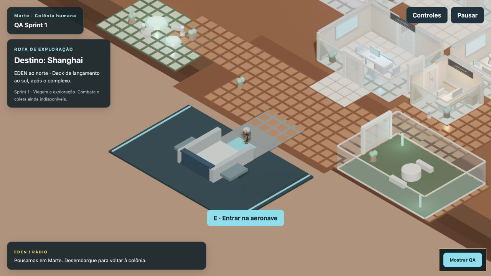
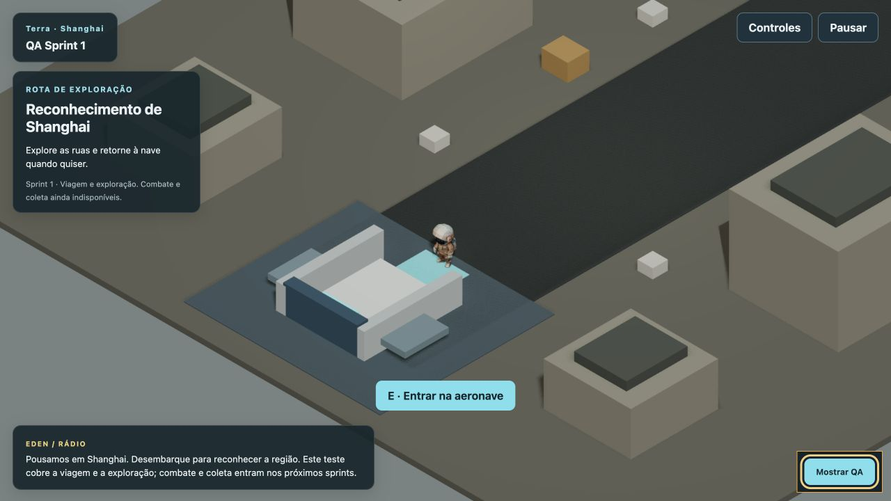

# Sprint 1 — Base local e viagem Marte–Shanghai

Concluído em 29/09/2026 na branch `rochatales/horda-survivor`. Sem commit/push automático. Escopo: exploração e transporte; não inclui combate, loot, ondas ou fabricação.

## Entrega

- Produto MCP retirado do runtime: onboarding de clientes, decks, workflow, Smart Lab, outros NPCs e beacon antigo.
- Fontes, backend e exports inativos preservados em `archive/mcp-office/`. Foram comparados 116 arquivos arquivados ao commit original; todos são idênticos. O snapshot do Sprint 0 permanece disponível.
- EDEN com roteiro local. Identidade migrada do save antigo (nome/cor), sem conexões ou tarefas do produto anterior.
- Save versionado `horda-survivor:hub:v1`, com perfil e briefing; sessão, posição e viagem não são persistidas. Ao recarregar, entrada no hub.
- Deck de lançamento ao sul: corredor caminhável até plataforma, aeronave com cabine aberta, colisão nas laterais e rampa frontal.
- Aproximar → embarcar → escolher partida. Entrar não decola; desembarcar devolve ao mesmo mapa.
- Viagem para Shanghai e retorno a Marte, com saída segura no deck. Repetição de comando não dispara duas viagens.
- Shanghai em geometria simples: ruas, prédios/obstáculos, local de pouso e marcadores para futuros depósitos/placas. Nenhum marcador concede itens neste sprint.
- Falha de carregamento permite nova tentativa; falha ao salvar gera aviso. UI não depende da antiga API.
- Câmera mantida ortográfica; rotação passou para Q/C para reservar R à recarga futura. Input de movimento é liberado ao perder foco.
- Labels do mapa usam lettering local em canvas, evitando dependência de uma fonte hospedada fora do projeto.

## Validação executada

`npm test`: **9 testes passaram**, cobrindo embarque sem partida, viagem completa/repetição de eventos, falha de viagem, saves antigos/corrompidos/futuros, distância e pausa, falha de escrita e conectividade geométrica dos mapas.

O teste de navegação usa as áreas transitáveis e obstáculos reais, com margem de raio de 0,36 m. Verifica ponto inicial → EDEN, ponto inicial → deck, deck → laboratório e acesso a pontos de Shanghai. É evidência geométrica, não substituto de todo o playtest manual.

`npm run build`: passou. `git diff --check`: passou.

### Teste no navegador

Executado no Codex In-app Browser com servidor de desenvolvimento em origem isolada `127.0.0.1:5180`, usando `tests/browser-smoke.html`. A fixture prepara a posição do jogador perto dos pontos de teste; os diálogos, botões, física e viagens são os mesmos da aplicação. Não foi alegado um percurso completo a pé feito manualmente.

- Abrir conversa local de EDEN e fechar: passou.
- Input sustentado por 1 segundo no deck: deslocamento medido de **2,52 m**, com física ativa.
- Embarcar em Marte, desembarcar sem viajar e embarcar novamente: passou.
- Partir para Shanghai, desembarcar, embarcar e retornar: passou.
- Repetir ida/volta até completar três ciclos após a última atualização: passou, sem erros de console capturados.
- Voltar e desembarcar no deck de Marte: passou.
- Build de produção servido em `127.0.0.1:4173`: entrada com perfil novo e reload mantendo identidade verificados. Sem backend iniciado.

### Amostra de frames — limitada ao ambiente de teste

Intervalos de requestAnimationFrame, amostra de cinco segundos por mapa, em repouso e sem inimigos:

| Cena | Frames | Mediana | p95 |
| --- | ---: | ---: | ---: |
| Shanghai | 596 | 8,3 ms | 9,3 ms |
| Deck de Marte | 601 | 8,3 ms | 9,2 ms |

Esses valores medem cadência de callbacks, não tempo de GPU. Não garantem desempenho da futura horda nem equivalem à medição manual anterior que ficou pendente no Sprint 0. Hardware de referência: MacBook Pro M2 Pro, 16 GB; captura do teste em 1280 × 720. Avaliação em outros dispositivos permanece necessária.

## Tamanho do build

- GLBs ativos: aproximadamente **51,42 MB**, frente a 148,56 MB no baseline; só player e EDEN são emitidos.
- JS principal: **3.163,91 kB**, gzip **1.074,58 kB**. O aviso de chunk grande permanece.
- Mundo de Marte: chunk separado de 32,00 kB; Shanghai: 0,75 kB.
- CSS principal: 3,07 kB.

A redução vem da retirada de conteúdo inativo. Compressão/retopologia dos modelos não foi feita; faz parte do trabalho posterior de assets. Os assets originais de produção não foram reorganizados em massa.

## Evidências

## Como avaliar

1. Abrir `http://127.0.0.1:5178/` e entrar na colônia.
2. Caminhar até EDEN ao norte e pressionar E.
3. Seguir ao sul, passando pelo complexo até a plataforma de lançamento.
4. Entrar na nave com E, testar desembarque e depois escolher Decolar para Shanghai.
5. Desembarcar em Shanghai, explorar e voltar à rampa da nave.
6. Embarcar, escolher Retornar a Marte e desembarcar no deck.

O retorno é livre nesta versão para validar o transporte. No sprint 4, ficará vinculado às hordas e à carga da introdução. O botão de retorno temporário não concede recompensa.

## Próximo sprint

Sprint 2: movimento/mira independentes, rifle, recarga, HP, dano, morte e reinício, com um inimigo simples. A forma da nave, cenário, animações adicionais e texturas finais permanecem provisórias, conforme a prioridade de jogabilidade.
